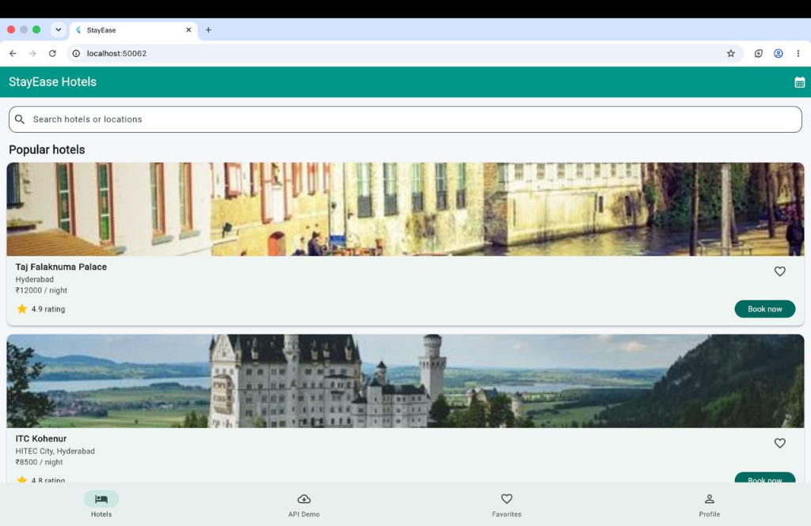
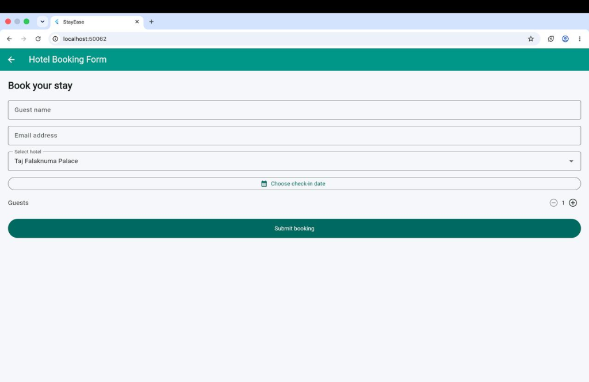
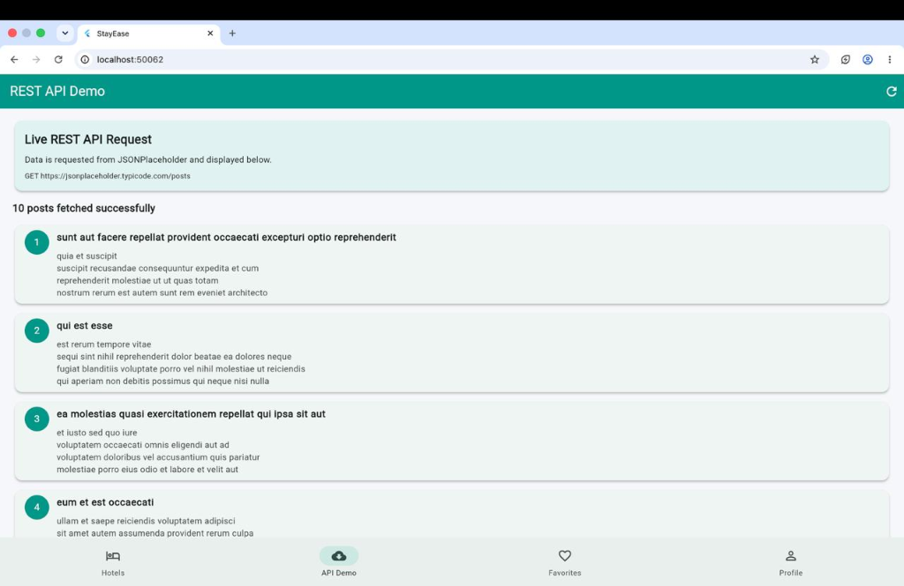
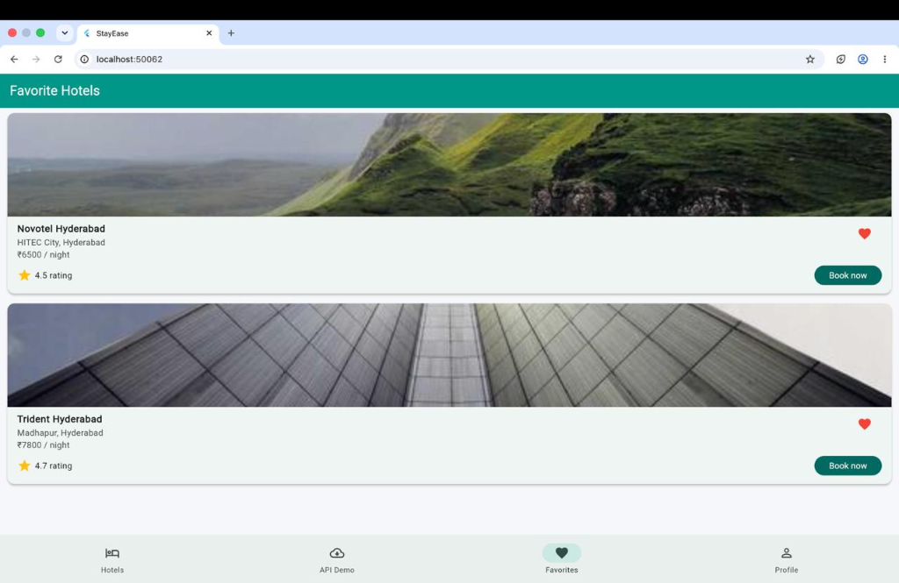
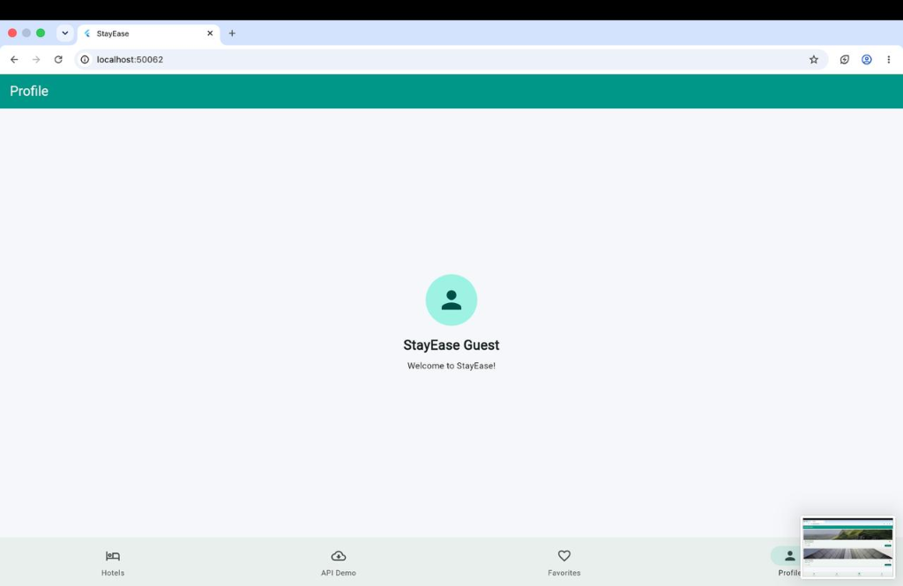

# StayEase - Hotel Booking App

A modern, responsive Flutter application for discovering and booking luxury hotel stays in Hyderabad, featuring Provider-based state management, REST API integration, smooth animations, and form validation.

---

## 📱 App Screenshots

### 1. Home & Popular Hotels
Browse popular hotels with real-time pricing, ratings, and instant booking options.


### 2. Hotel Booking Form
Interactive booking form with guest validation, date picker, and guest count controls.


### 3. REST API Integration
Live demonstration of async REST API data fetching and state handling.


### 4. Favorites Screen
Stateful favorite hotels management powered by Flutter Provider.


### 5. Profile Screen
User profile view with custom navigation bar styling.


---

## ✨ Features

- **Hotel Discovery**: Explore top luxury hotels with images, locations, ratings, and pricing.
- **Booking Management**: Interactive booking form with field validation, date selection, and guest counters.
- **Favorites System**: Bookmark preferred hotels with persistent state using `Provider` (`ChangeNotifier`).
- **REST API Demo**: Asynchronous network fetching and error/loading handling.
- **Animations**: Fluid slide and fade animations between views.
- **Modern UI**: Clean Material 3 design with a teal-themed palette.
- **Widget Testing**: Unit and widget test suite for validating core components.

---

## 🚀 Getting Started

### Prerequisites
- [Flutter SDK](https://flutter.dev/docs/get-started/install) (v3.0.0 or higher)
- [Dart SDK](https://dart.dev/get-dart)

### Installation & Run

1. **Clone the repository:**
   ```bash
   git clone https://github.com/nishanthreddyvemireddy-ai/Hotel_Booking_App.git
   cd Hotel_Booking_App
   ```

2. **Install dependencies:**
   ```bash
   flutter pub get
   ```

3. **Run the application:**
   ```bash
   flutter run
   ```

4. **Run tests:**
   ```bash
   flutter test
   ```
