# StayEase - Hotel Booking Flutter Application

This repository contains the implementation of StayEase, a modern and responsive Hotel Booking Flutter Application. The application integrates hotel discovery, booking management, favourite hotel management, REST API integration, responsive layouts, Provider-based state management, animations, and form validation into a cohesive Flutter application.

The project demonstrates the practical implementation of 10 core mobile application development concepts using Flutter and Dart.

---

## 📌 Project Overview

StayEase is a hotel booking application developed using Flutter and Dart. It provides users with an interactive platform to discover hotels, explore hotel details, view pricing and ratings, manage favourite hotels, and access the hotel booking interface.

The application combines modern Material Design 3 UI components with Provider-based state management and asynchronous REST API communication.

### Main Features

- **Hotel Discovery:** Explore luxury hotels with images, locations, ratings, and pricing.
- **Booking Management:** Interactive hotel booking form with guest validation, date selection, and guest count controls.
- **Favorites System:** Save and manage favourite hotels using Provider and ChangeNotifier.
- **REST API Integration:** Demonstrates asynchronous network requests and API response handling.
- **Responsive Interface:** Provides an adaptable interface for different screen dimensions.
- **Animations:** Implements smooth slide and fade transitions.
- **Modern UI:** Uses Material Design 3 with a teal-themed colour palette.
- **Widget Testing:** Includes a test directory for application testing.

---

## 🗺 Prescribed Syllabus Concept Mapping

The following table maps the 10 experiments from the prescribed Flutter syllabus to their corresponding implementation in the StayEase Hotel Booking Application.

| Exp # | Prescribed Syllabus Topic | Concepts Covered | Implementation in StayEase |
|---|---|---|---|
| 1 | SDK Setup & Dart Basics | Flutter SDK, Dart OOP, variables, collections, async programming | Flutter environment configuration and Dart programming concepts used in hotel data and application logic |
| 2 | Widgets & Layout Structures | Text, Image, Icon, Container, Row, Column, Stack | Hotel cards, hotel images, pricing, ratings, and booking interface |
| 3 | Responsive UI & Breakpoints | MediaQuery, LayoutBuilder, responsive layouts | Responsive hotel listing, booking interface, and screen-size adjustments |
| 4 | Screen Navigation & Named Routes | Navigator, routes, screen transitions | Navigation between Home, Booking, Favorites, and Profile screens |
| 5 | Stateful/Stateless & State Management | StatefulWidget, StatelessWidget, setState, Provider | Interactive hotel components and favourite hotel management using ChangeNotifier |
| 6 | Custom Widgets & Themes | Reusable widgets, Material themes, custom styling | Hotel cards, reusable interface components, and teal-themed Material Design 3 styling |
| 7 | Forms & Form Validation | Form, TextFormField, validation, input controls | Booking form with guest validation, date selection, and guest count controls |
| 8 | Flutter Animation Framework | AnimationController, FadeTransition, SlideTransition | Smooth fade and slide animations between application views |
| 9 | REST API Integration | HTTP GET, JSON parsing, asynchronous Future handling | Asynchronous REST API data fetching and loading/error state handling |
| 10 | Testing & Debugging Tools | flutter_test, widget testing, flutter analyze | Automated testing of core application components and debugging |

---

## 🏛 System Architecture & Data Flow

The StayEase application follows a modular Flutter architecture that separates the user interface, state management, and network communication.

### Architecture Diagram

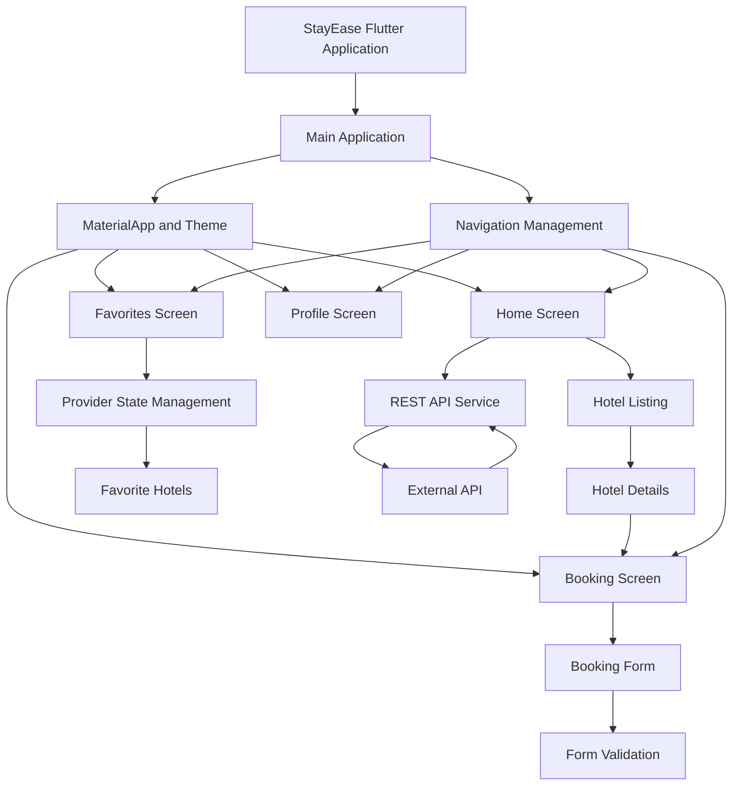

### Application Workflow

1. The application starts through the main Flutter entry point.
2. The home screen displays hotel information and available hotel options.
3. Users explore hotel images, locations, ratings, and pricing.
4. Users navigate to the booking interface.
5. The booking form accepts guest information and booking details.
6. Form validation checks the entered information.
7. Users can save and manage favourite hotels.
8. Provider manages favourite-related application state.
9. REST API communication retrieves external data asynchronously.
10. The interface handles loading, successful responses, and errors.

---

## 🔬 Detailed Implementation Evidence & Experiment Screenshots

This section explains the implementation of the 10 experiments from the prescribed Flutter and Dart syllabus using the StayEase Hotel Booking Application.

### Experiment 1: a) Install Flutter & Dart SDK | b) Dart Basics Program

**Syllabus Aim:**

1(a): Install Flutter and Dart SDK.

1(b): Write a simple Dart program to understand the language basics.

**Implementation in Project:**

- Configured the Flutter development environment.
- Verified Flutter and Dart SDK installation.
- Used Dart variables and data types.
- Applied object-oriented programming concepts.
- Used classes and constructors to represent application data.
- Understood lists and collections for storing hotel information.
- Used asynchronous programming concepts for application operations.

**Code Extract – Illustrative Dart Hotel Model:**

```dart
class Hotel {
  final String name;
  final String location;
  final double price;

  Hotel({
    required this.name,
    required this.location,
    required this.price,
  });
}
```

The example demonstrates Dart classes, constructors, variables, and object-oriented programming concepts used to represent hotel information.

**Screenshot Evidence:**


**Result:**

Successfully understood Flutter environment configuration and Dart programming fundamentals required for developing the hotel booking application.

---

### Experiment 2: a) Flutter Widgets | b) Layout Structures

**Syllabus Aim:**

2(a): Explore various Flutter widgets such as Text, Image, Icon, and Container.

2(b): Implement different layout structures using Row, Column, and Stack widgets.

**Implementation in Project:**

- **Text:** Displays hotel names, locations, prices, and descriptions.
- **Image:** Displays hotel photographs and visual content.
- **Icon:** Represents favourite actions and interface controls.
- **Container:** Provides styling, padding, margins, and backgrounds.
- **Column:** Arranges hotel information vertically.
- **Row:** Aligns hotel ratings, pricing, and other details horizontally.
- **Stack:** Supports overlapping interface elements where required.
- **Card:** Organizes hotel information into individual cards.
- **ListView:** Displays multiple hotel items.

**Code Extract – Illustrative Hotel Information Layout:**

```dart
Column(
  crossAxisAlignment: CrossAxisAlignment.start,
  children: [
    Image.network(hotelImage),
    Text(hotelName),
    Text(hotelLocation),
    Row(
      children: [
        Icon(Icons.star),
        Text(hotelRating),
      ],
    ),
    Text(hotelPrice),
  ],
)
```

**Screenshot Evidence:**


**Result:**

Successfully demonstrated Flutter widgets and layout structures through the hotel information and booking interfaces.

---

### Experiment 3: a) Responsive UI | b) Media Queries & Breakpoints

**Syllabus Aim:**

3(a): Design a responsive user interface that adapts to different screen sizes.

3(b): Implement media queries and breakpoints for responsiveness.

**Implementation in Project:**

- Designed responsive hotel listing screens.
- Used flexible layouts to organize hotel information.
- Adjusted widget dimensions according to screen constraints.
- Implemented responsive image layouts.
- Used MediaQuery or LayoutBuilder where appropriate.
- Maintained consistent spacing and alignment.
- Improved the usability of booking screens across different screen dimensions.

**Code Extract – Illustrative Responsive Layout:**

```dart
LayoutBuilder(
  builder: (context, constraints) {
    return Container(
      width: constraints.maxWidth,
      padding: const EdgeInsets.all(16),
      child: const Text(
        'StayEase Hotel Booking',
      ),
    );
  },
)
```

**Screenshot Evidence:**

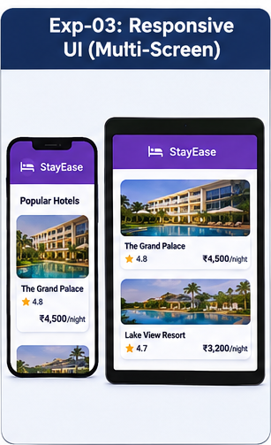

**Result:**

Demonstrated responsive Flutter layout concepts for adapting the hotel booking interface to different screen dimensions.

---

### Experiment 4: a) Screen Navigation with Navigator | b) Named Routes

**Syllabus Aim:**

4(a): Set up navigation between different screens using Navigator.

4(b): Implement navigation using named routes.

**Implementation in Project:**

- Implemented navigation between application screens.
- Home screen provides access to hotel information.
- Booking screen displays the hotel booking interface.
- Favorites screen displays saved hotels.
- Profile screen displays user-related interface information.
- Implemented screen transitions and back navigation.
- Organized navigation between major application sections.

**Code Extract – Illustrative Navigation:**

```dart
Navigator.push(
  context,
  MaterialPageRoute(
    builder: (context) => const BookingScreen(),
  ),
);
```

**Screenshot Evidence:**


**Result:**

Successfully demonstrated navigation between different sections of the StayEase application.

---

### Experiment 5: a) Stateful & Stateless Widgets | b) State Management

**Syllabus Aim:**

5(a): Learn about StatefulWidget and StatelessWidget.

5(b): Implement state management using setState and Provider.

**Implementation in Project:**

- Used StatelessWidget concepts for reusable interface components.
- Used StatefulWidget concepts for interactive application elements.
- Implemented Provider for favourite hotel management.
- Used ChangeNotifier to manage favourite-related application state.
- Updated the interface when favourite hotel information changed.
- Used reactive state management to maintain consistent UI updates.

**Code Extract – Illustrative Provider Implementation:**

```dart
class FavoriteProvider extends ChangeNotifier {
  final List<String> favorites = [];

  void addFavorite(String hotel) {
    favorites.add(hotel);
    notifyListeners();
  }

  void removeFavorite(String hotel) {
    favorites.remove(hotel);
    notifyListeners();
  }
}
```

The Provider class demonstrates how application state can be updated and how listeners can be notified when favourite hotel information changes.

**Screenshot Evidence:**


**Result:**

Successfully demonstrated state management concepts using Provider and ChangeNotifier for managing favourite hotel information.

---

### Experiment 6: a) Custom Widgets | b) Themes and Custom Styles

**Syllabus Aim:**

6(a): Create custom widgets for specific user interface elements.

6(b): Apply styling using themes and custom styles.

**Implementation in Project:**

- Created reusable hotel interface components.
- Designed hotel information cards.
- Applied consistent text styles.
- Used Material Design 3 styling.
- Applied a teal-themed colour palette.
- Maintained consistent padding and spacing.
- Improved interface consistency through reusable components.

**Code Extract – Illustrative Custom Hotel Card:**

```dart
Card(
  elevation: 4,
  child: Padding(
    padding: const EdgeInsets.all(12),
    child: Column(
      crossAxisAlignment: CrossAxisAlignment.start,
      children: [
        const Text(
          'Luxury Hotel',
          style: TextStyle(
            fontSize: 18,
            fontWeight: FontWeight.bold,
          ),
        ),
        const SizedBox(height: 8),
        const Text('Comfortable Stay'),
        const Text('Premium Accommodation'),
      ],
    ),
  ),
)
```

**Screenshot Evidence:**

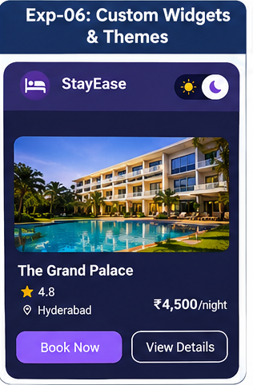

**Result:**

Successfully demonstrated reusable Flutter components and consistent application styling using Material Design 3.

---

### Experiment 7: a) Form with Input Fields | b) Form Validation & Error Handling

**Syllabus Aim:**

7(a): Design a form with various input fields.

7(b): Implement form validation and error handling.

**Implementation in Project:**

- Developed an interactive hotel booking form.
- Added guest information input fields.
- Implemented guest validation.
- Provided date selection controls.
- Implemented guest count controls.
- Displayed validation messages for incorrect inputs.
- Managed booking form submission.

**Code Extract – Illustrative Booking Form Validation:**

```dart
final _formKey = GlobalKey<FormState>();

Form(
  key: _formKey,
  child: TextFormField(
    decoration: const InputDecoration(
      labelText: 'Guest Name',
      border: OutlineInputBorder(),
    ),
    validator: (value) {
      if (value == null || value.trim().isEmpty) {
        return 'Please enter guest name';
      }

      return null;
    },
  ),
)
```

**Screenshot Evidence:**


**Result:**

Successfully demonstrated form design, input validation, and error handling through the hotel booking interface.

---

### Experiment 8: a) Flutter Animation Framework | b) Fade and Slide Animations

**Syllabus Aim:**

8(a): Add animations to UI elements using Flutter's animation framework.

8(b): Experiment with different types of animations such as fade and slide.

**Implementation in Project:**

- Implemented smooth interface transitions.
- Used fade animation concepts.
- Used slide animation concepts.
- Improved screen transition effects.
- Applied animation techniques to enhance the application experience.

**Code Extract – Illustrative Fade and Slide Animation:**

```dart
SlideTransition(
  position: slideAnimation,
  child: FadeTransition(
    opacity: fadeAnimation,
    child: const Text(
      'StayEase Hotel Booking',
    ),
  ),
)
```

**Screenshot Evidence:**

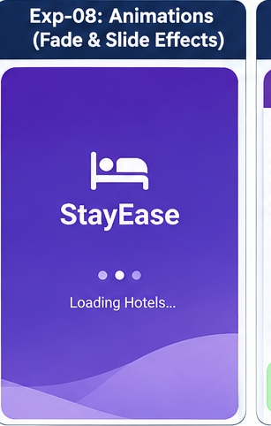

**Result:**

Successfully demonstrated Flutter animation concepts through smooth fade and slide transitions.

---

### Experiment 9: a) Fetch Data from REST API | b) Display Data with FutureBuilder

**Syllabus Aim:**

9(a): Fetch data from a REST API.

9(b): Display the fetched data in a meaningful way in the user interface.

**Implementation in Project:**

- Integrated REST API communication.
- Implemented asynchronous network requests.
- Used HTTP GET requests for retrieving data.
- Processed API responses.
- Handled asynchronous data fetching.
- Implemented loading and error handling states.
- Demonstrated API data handling within the application.

**Code Extract – Illustrative REST API Request:**

```dart
import 'dart:convert';
import 'package:http/http.dart' as http;

Future<dynamic> fetchHotelData() async {
  final response = await http.get(
    Uri.parse('YOUR_ACTUAL_API_ENDPOINT'),
  );

  if (response.statusCode == 200) {
    return jsonDecode(response.body);
  }

  throw Exception('Failed to load hotel data');
}
```

**Screenshot Evidence:**

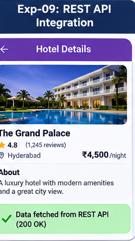

**Result:**

Successfully demonstrated REST API integration, asynchronous network communication, and response handling.

---

### Experiment 10: a) Unit & Widget Testing | b) Debugging Tools

**Syllabus Aim:**

10(a): Write tests for Flutter application components.

10(b): Use Flutter debugging tools to identify and fix issues.

**Implementation in Project:**

- Organized automated testing in the test directory.
- Used Flutter testing tools.
- Verified application interface components.
- Tested important user interface interactions.
- Checked application behaviour.
- Used Flutter static analysis.
- Identified and corrected development errors.

**Commands Used:**

```bash
flutter analyze
flutter test
```

**Screenshot Evidence:**

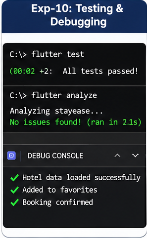

**Result:**

Demonstrated Flutter testing and debugging techniques for verifying application components and identifying potential issues.

---

## 📸 Application Screenshots

The following screenshots demonstrate the major user interface sections of the StayEase Hotel Booking Application.

### 1. Home & Popular Hotels

Browse popular hotels with hotel images, locations, ratings, pricing, and booking options.

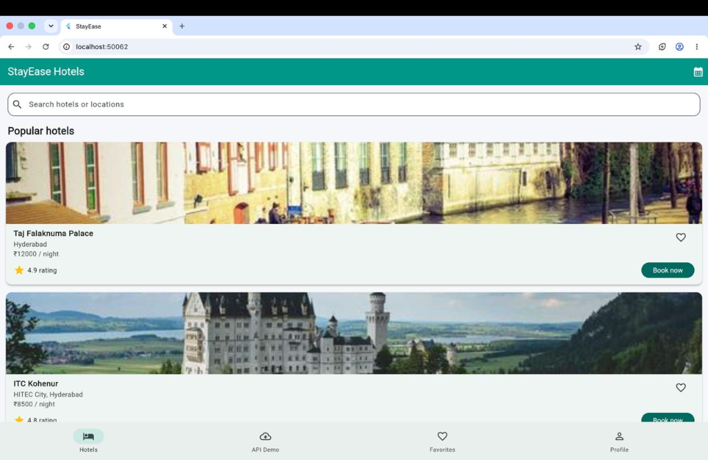

### 2. Hotel Booking Form

Interactive booking interface with guest validation, date selection, and guest count controls.

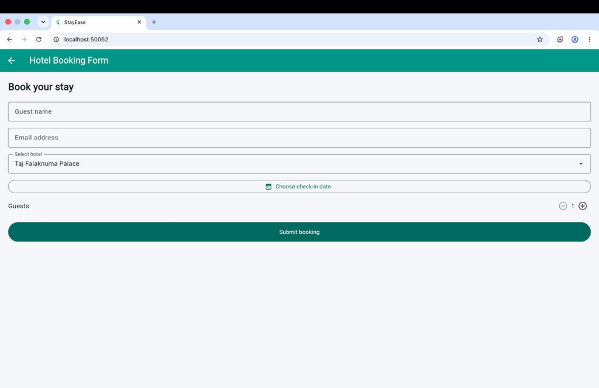

### 3. REST API Integration

Demonstration of asynchronous REST API data fetching and application state handling.

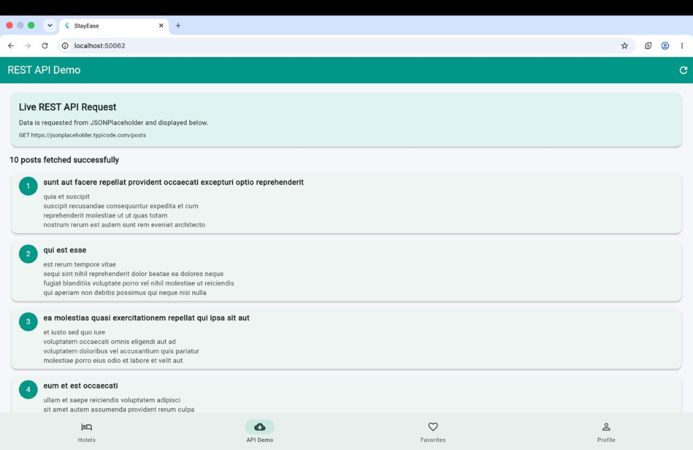

### 4. Favorites Screen

Manage favourite hotels using Provider-based state management.

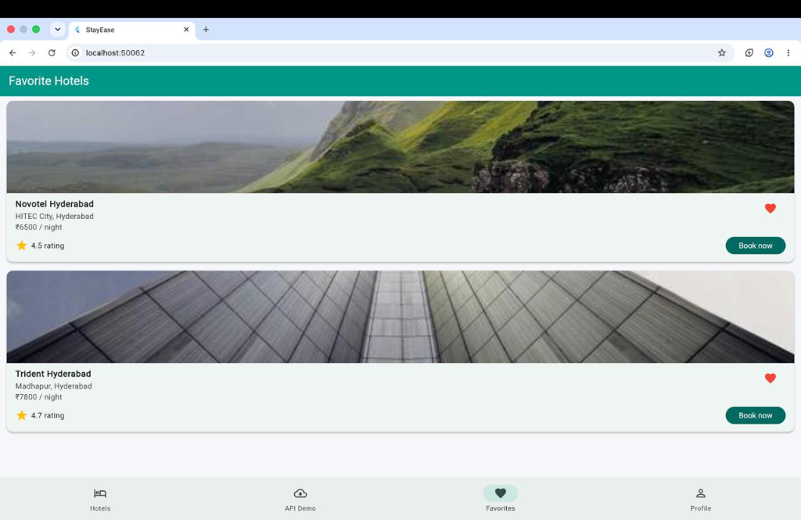

### 5. Profile Screen

User profile interface with customized navigation styling.

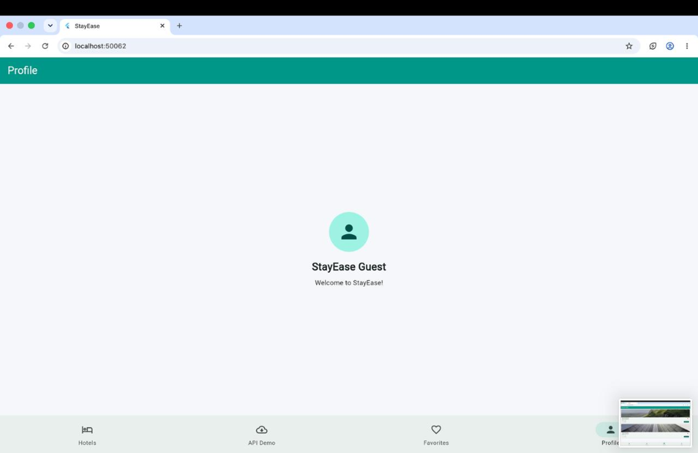

---

## 📂 Repository Directory Structure

The repository contains the Flutter application source code, platform-specific folders, screenshots, and testing resources.

```text
Hotel_Booking_App/
│
├── android/                   # Android platform configuration
│
├── ios/                       # iOS platform configuration
│
├── linux/                     # Linux platform configuration
│
├── macos/                     # macOS platform configuration
│
├── web/                       # Web platform configuration
│
├── windows/                   # Windows platform configuration
│
├── lib/                       # Main Flutter application source code
│
├── screenshots/               # Application screenshots
│
├── test/                      # Automated testing resources
│
├── .gitignore                 # Git ignored files
│
├── .metadata                  # Flutter project metadata
│
├── analysis_options.yaml      # Dart analysis configuration
│
├── pubspec.lock               # Locked dependency versions
│
├── pubspec.yaml               # Project dependencies and configuration
│
└── README.md                  # Project documentation
```

### Important Project Files

| File/Directory | Description |
|---|---|
| lib/ | Contains the main Flutter application source code |
| android/ | Android platform configuration |
| ios/ | iOS platform configuration |
| linux/ | Linux platform configuration |
| macos/ | macOS platform configuration |
| web/ | Web platform configuration |
| windows/ | Windows platform configuration |
| screenshots/ | Stores application screenshots |
| test/ | Contains testing resources |
| pubspec.yaml | Defines Flutter dependencies and project configuration |
| pubspec.lock | Stores resolved dependency versions |
| analysis_options.yaml | Configures Dart static analysis |
| README.md | Contains project documentation |

---

## 🚀 How to Run and Test the Project

### 1. Prerequisites

Before running the application, ensure that the following tools are installed:

- Flutter SDK (version 3.0.0 or higher, as specified in the repository README).
- Dart SDK.
- Android Studio or Visual Studio Code.
- Android Emulator or a physical device.
- Git.

### 2. Clone the Repository

```bash
git clone https://github.com/nishanthreddyvemireddy-ai/Hotel_Booking_App.git

cd Hotel_Booking_App
```

### 3. Install Dependencies

```bash
flutter pub get
```

### 4. Check Flutter Environment

```bash
flutter doctor
```

### 5. Run Static Code Analysis

```bash
flutter analyze
```

### 6. Run Automated Widget Tests

```bash
flutter test
```

### 7. Run the Application

```bash
flutter run
```

### 8. Build Android APK

```bash
flutter build apk
```

---

## 🎓 Technical Project Information

**Project Name:** StayEase - Hotel Booking Application

**Domain:** Cross-Platform Mobile Application Development

**Programming Language:** Dart

**Framework:** Flutter

**UI Design:** Material Design 3

**State Management:** Provider and ChangeNotifier

**API Integration:** REST API using HTTP

**Development Environment:** Android Studio / Visual Studio Code

**Testing Framework:** Flutter Test

**Version Control:** Git and GitHub

### Key Learning Outcomes

Through this project, the following concepts are demonstrated:

1. Flutter SDK installation and environment configuration.
2. Dart programming fundamentals and object-oriented programming.
3. Flutter widgets and layout structures.
4. Responsive user interface design.
5. Navigation and routing between screens.
6. Stateful and Stateless widgets.
7. State management using Provider.
8. Custom widgets and Material Design themes.
9. Form creation and validation.
10. Flutter animation framework.
11. REST API integration and asynchronous programming.
12. Automated testing and debugging.

### Conclusion

The StayEase Hotel Booking Application demonstrates the practical implementation of Flutter and Dart programming concepts through a modern hotel booking interface.

The application combines hotel discovery, booking forms, favourite hotel management, responsive layouts, Provider-based state management, REST API communication, animations, and testing.

The project provides practical experience in developing interactive and user-friendly cross-platform applications using Flutter.

---

## 🔗 Project Repository

GitHub Repository:

https://github.com/nishanthreddyvemireddy-ai/Hotel_Booking_App

**Project:** StayEase - Hotel Booking Application

**Framework:** Flutter

**Programming Language:** Dart
